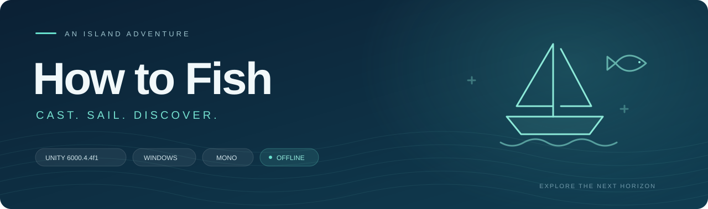
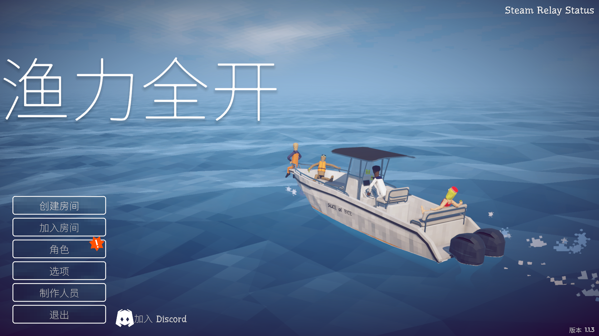
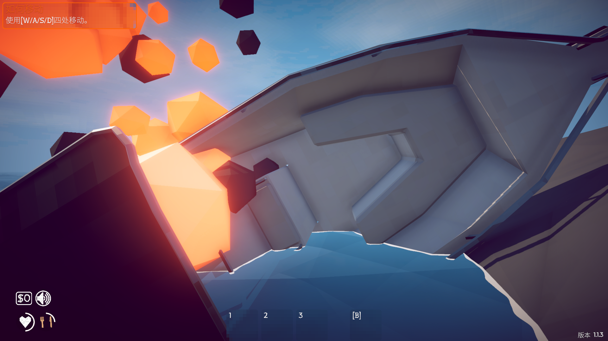

  

<h1 align="center">How to Fish · 渔力全开</h1>

<strong>Unity 6 易读恢复版</strong> 从抛下第一根鱼线，到驶向下一座岛屿。

  
  
  

  
  

  <a href="#游戏画面">游戏画面</a> · <a href="#开始游玩">开始游玩</a> · <a href="#打开工程">打开工程</a> · <a href="#代码导航">代码导航</a> · <a href="#验证与说明">验证与说明</a>

---

将游戏资源与 C# 实现恢复为可研究、修改的 Unity 工程，同时提供解压即可运行的 Windows 本地游玩版。代码经过进一步可读性整理，保留场景引用、序列化字段和运行流程。

<table>
<tr>
<td width="33%" valign="top"> <strong>钓鱼与收获</strong> 抛竿、咬钩、收线与鱼类权重。</td>
<td width="33%" valign="top"> <strong>船只与航行</strong> 船只升级、驾驶与海上探索。</td>
<td width="33%" valign="top"> <strong>岛屿与任务</strong> 岛屿场景、NPC 与任务流程。</td>
</tr>
<tr>
<td valign="top"> <strong>交易与成长</strong> 物品栏、交易与经济系统。</td>
<td valign="top"> <strong>角色与装扮</strong> 角色外观、换装与存档数据。</td>
<td valign="top"> <strong>战斗与挑战</strong> 生命状态、复活与 Boss 逻辑。</td>
</tr>
</table>

##  游戏画面

**启航之前 · 主菜单**

<strong>展开查看本地游戏实机画面</strong>

下图为新建世界后的开场画面。两张截图均来自本仓库 Windows 构建的实际运行。

##  开始游玩

|  01 · 下载 |  02 · 解压 |  03 · 启动 |
| --- | --- | --- |
| 前往 **[Releases](https://github.com/AuR3L1US07/HowToFish-Unity6/releases/latest)**，下载 Windows x64 ZIP。 | **完整解压**到可写入的文件夹，保留所有配套目录。 | 运行 **`HowToFish.exe`**，通过“创建房间”进入本地世界。 |

**无需 Steam 启动。** 当前发布范围为本地游玩，Steam 联机未验收。更新前请备份个人存档；Release 附有 `SHA256SUMS.txt` 校验文件。

##  打开工程

| 环境 | 要求 |
| --- | --- |
| Unity 编辑器 | **6000.4.4f1** |
| 构建目标 | Windows 64 位，安装 Windows 构建支持 |
| 启动场景 | [Assets/Scenes/Game.unity](Assets/Scenes/Game.unity) |

克隆仓库后，在 Unity Hub 中添加仓库根目录，等待首次导入与编译，再打开 Game 场景进入 Play 模式。

保留 Assets 下的 `.meta` 文件和 Packages 中的本地依赖。仓库不包含 Library 缓存、构建产物和个人存档。

##  代码导航

主要游戏逻辑位于 **[Assets/Scripts/Assembly-CSharp](Assets/Scripts/Assembly-CSharp)**。

| 模块 | 阅读入口 |
| --- | --- |
|  抛竿与鱼线 | [FishingRod](Assets/Scripts/Assembly-CSharp/FishingRod.cs) · [FishingRodCast](Assets/Scripts/Assembly-CSharp/FishingRodCast.cs) |
|  咬钩与鱼类权重 | [Bait](Assets/Scripts/Assembly-CSharp/Bait.cs) · [CreatureManager](Assets/Scripts/Assembly-CSharp/CreatureManager.cs) |
|  移动与拾取 | [PlayerMovement](Assets/Scripts/Assembly-CSharp/PlayerMovement.cs) · [PlayerHolding](Assets/Scripts/Assembly-CSharp/PlayerHolding.cs) |
|  物品栏 | [PlayerInventory](Assets/Scripts/Assembly-CSharp/PlayerInventory.cs) · [InventorySlot](Assets/Scripts/Assembly-CSharp/InventorySlot.cs) |
|  存档与恢复 | [SaveManager](Assets/Scripts/Assembly-CSharp/SaveManager.cs) · [SaveSystem](Assets/Scripts/Assembly-CSharp/SaveSystem.cs) |
|  本地启动 | [LocalPlayMode](Assets/Scripts/Assembly-CSharp/LocalPlayMode.cs) · [ConnectionManager](Assets/Scripts/Assembly-CSharp/ConnectionManager.cs) |
|  生命与饱食度 UI | [VitalsUI](Assets/Scripts/Assembly-CSharp/VitalsUI.cs) · [PlayerUI](Assets/Scripts/Assembly-CSharp/PlayerUI.cs) |

### 更容易读懂的 C#

| 整理文件 | 目标类型 `new()` | 声明核对 | 脚本与 GUID |
| :---: | :---: | :---: | :---: |
| **98** 个 | **256** 处 | **10,191** 项 | **366** 份 |

基于语义绑定重命名部分局部变量，简化存档分支，并补充关键逻辑注释。类名、序列化字段、方法签名与 FishNet 生成代码保持兼容；不能确认语义的临时变量保留原名。

 [人工整理说明](Documentation/Readability/manual-changes.md) · [修改清单](Documentation/Readability/changes.json) · [声明核对](Documentation/Readability/declaration-audit.json)

##  验证与说明

| 检查项目 | 结果 |
| --- | --- |
| Windows 正式构建 | 12 个启用场景，**构建错误为 0** |
| 独立 EXE 新建世界 | 本地服务、客户端与玩家生成检查通过 |
| 存档与重启读档 | 写入、读回和已保存状态核对通过 |
| 最终运行验收 | 错误列表为空 |

[发布验证结果](Documentation/Readability/ReleaseValidation) · [恢复验收记录](Documentation/OfflineRecoveryAcceptance.md) · [完整文档](Documentation)

自动检查不代表完整正常难度通关，也不保证视觉逐像素等同原版。

---

<strong>恢复、阅读、探索。</strong> 这是从发布产物恢复并进一步整理的工程，不是原作者的原始源码。

原游戏与第三方组件权利归各自权利人所有，保留第三方许可；本仓库未附加统一开源许可证。详见 [分享与权利说明](SHARING.md)。
