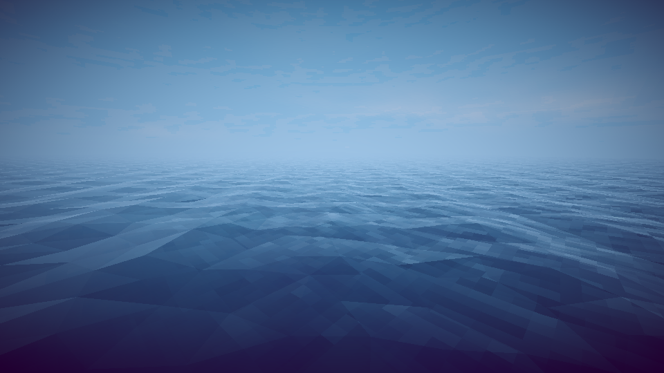

# How to Fish — Unity 6 恢复工程

从游戏发布产物恢复并修复的 Unity 工程，不是开发者原始仓库。当前以 Windows 离线游玩为目标，使用 **Unity 6000.4.4f1**、**Mono** 脚本后端和 URP 17.4.0。Steam 大厅、好友邀请和 Steam 联机不在恢复范围。

## 打开与运行

1. 克隆仓库，在 Unity Hub 中“添加现有项目”，选择仓库根目录。
2. 使用 Unity **6000.4.4f1** 打开，等待包解析、源码编译和资源导入完成。
3. 在 Project 面板双击 **Assets/Scenes/Game.unity**，再进入 Play。
4. 通过游戏菜单创建或载入本地游戏。

如果只看到天空、相机和灯光，请检查是否打开了 `Untitled` 空场景。游戏入口是 `Game.unity`，清理 Library 后可能需要重新打开它。

`.meta` 文件和 Packages 中的本地源码包必须保留。不要把 ReferenceOnly 中的备份 DLL 放回 Assets，也不要降级到 Unity 2022 打开。

## 当前恢复内容

- 游戏主程序集和 firstpass 使用恢复的 C# 源码。
- Addressables、Localization、Animation Rigging、AI Navigation、Transport、VFX Graph 等使用官方兼容源码包；并非已经证明与原开发者使用的每个包版本完全一致。
- FishNet、GameKit、FishyUnityTransport、Blur、Concentus、RNNoise 托管包装等依赖已迁移到源码程序集，保留原生成的网络调用逻辑。
- 离线启动、钓鱼、库存交易、NPC 任务、船升级与驾驶、武器、伤害和复活、换装、存档及 Boss/结局已有功能验证。
- 物品 Shader 补齐烹饪颜色、皮肤开关和图案；多种事件特效使用恢复的粒子实现。
- 运行时加载 `Assets/StreamingAssets/Recovery/original-shaders.bundle` 中的原版编译 Shader。水面专用渲染通道已同步使用原版材质，避免再次被近似 Shader 覆盖。

Unity 引擎、Steam 组件、部分框架以及原生插件仍包含正常运行所需的 DLL。工程不是完全无二进制依赖的项目，也不代表原生库已经恢复为 C#。

## 最新验证（2026-10-15）

| 范围 | 结果 |
| --- | --- |
| 设置、换装、配色与实际读档 | 52 项断言通过，包含外观遍历及重复读档保持相同穿戴 |
| 源码物品 Shader | 两份烹饪、两份皮肤开关及六组图案差异的 GPU 检查通过 |
| 原版水面资源 | 编译程序、顶点、索引和法线像素与原始资源逐字节一致 |
| 水面实际绘制通道 | Direct3D 12 下原 Shader/法线/网格及内部缓存材质检查通过 |
| Windows 构建 | 最新水面修复版构建成功，0 错误、274 警告；未关闭警告 |
| 更新后独立程序 | 实际启动，本地玩家、服务器、客户端及存档读回通过，运行错误列表为空 |

四个 Boss 的原奖杯交付、岛屿进度、最终结局，以及此前独立程序新进程读档的记录见下列文档。Boss 测试使用高伤害测试条件，部分捕鱼测试缩短等待时间，不代表完整正常难度通关。音源播放状态测试也不代表听感完全一致。

- [本轮检查与修复](Documentation/Review-2026-10-15.md)
- [水面恢复、资源依据与验证](Documentation/WaterResourceRecovery-2026-10-15.md)
- [物品表面源码重建](Documentation/ItemSurfaceReconstruction.md)
- [此前离线功能验证](Documentation/OfflineRecoveryValidation-2026-10-14.md)
- [验收范围](Documentation/OfflineRecoveryAcceptance.md)

## 画面说明

**进入 Play 或运行构建后的游戏查看原版编译 Shader 效果。** 编辑状态的可编辑 Shader 仍是重建预览。原始 Shader Graph 源文件没有完整恢复；功能和 GPU 验证通过不代表所有光照、天气、视角下与原版逐像素一致。

以下是同一恢复工程中修复渲染通道后的测试画面，并非原版游戏截图：



[同视角修复前画面](Documentation/WaterValidation-2026-10-15/water-before.png)

## Windows 打包

先保存并关闭该工程的 Unity 编辑器，再在仓库根目录运行 PowerShell；编辑器路径按本机安装位置修改：

```powershell
& 'E:\Unity\6000.4.4f1\Editor\Unity.exe' -batchmode -force-d3d11 -projectPath "$PWD" -executeMethod RecoveryBuildValidation.BuildWindows -logFile "$PWD\offline-build.log"
```

该入口会生成本地化和 Addressables 内容，备份冲突的旧 StreamingAssets 文件，再构建全部启用场景。结果写入 `CompilationChecks/offline-build-validation.json`，程序位于 `Builds/Offline/HowToFish.exe`。运行时必须保留同目录的数据文件和运行库，不能只复制 exe。

本仓库上传工程源码和资源，不上传本地 Build、Library、日志或测试存档；克隆后需要自行构建。部分本地分析文档引用的 ReferenceOnly、CompilationChecks、EditorRuntime 和工作区工具目录不随仓库分发。便于复核的精简结果保存在 Documentation 的 ValidationResults 和 WaterValidation 目录。

## 权利与来源

原游戏及第三方组件的权利归原权利人所有。仓库没有统一开源许可，不代表对其中全部资源、代码或二进制授予再分发或商业使用权。保留第三方组件自带的许可文件。更多信息见 [分享说明](SHARING.md)。